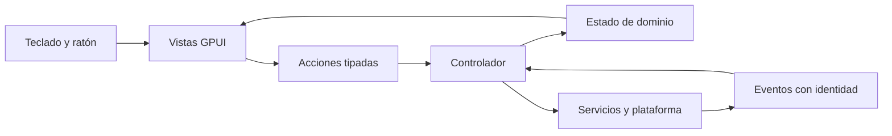

> Estado actualizado: este documento conserva la propuesta inicial. La implementación actual usa un workspace de siete crates, GPUI Kit 0.7.3 y un host WebView2 separado únicamente para contenido web. Windows está confirmado como plataforma; todas las funciones de backend son demos. Consulta [arquitectura implementada](../native/README.md) y [cobertura auditada](../native/catalog/COVERAGE.md). El mapa inicial no es una declaración de paridad alcanzada.
# Mapa de migración a Rust nativo
Propuesta inicial · 2026-10-12 · Basada en [FRONTEND.md](FRONTEND.md).

## Objetivo y supuestos
Recrear el lenguaje visual y las interacciones del frontend extraído mediante una aplicación Rust compilada, sin Electron y sin un WebView para dibujar la interfaz principal.
Windows es la plataforma de referencia provisional porque es la instalación inspeccionada. La prioridad inicial es la UI; el backend se sustituye por fixtures y una interfaz de servicios.
Este documento es diseño, no código implementado ni promesa de equivalencia completa. Las 20.119 entradas webview no son 20.119 componentes a traducir.

Éxito del mapa: cada área observada tiene responsabilidad, modelo de estado, entrada/salida, estrategia de portabilidad y una prueba de aceptación. Las áreas aún desconocidas quedan explícitas.

## Recomendación: evaluar GPUI con una prueba acotada
GPUI dibuja controles propios por GPU y expresa layout/estilos mediante una API Rust. Esto lo hace candidato para reproducir la estética observada. No usa widgets estándar de Windows para toda la interfaz.
Sus elementos y estado no son React ni DOM, y la compatibilidad CSS no es completa. Los tokens se pueden trasladar; los CSS y componentes JS requieren reimplementación.
La documentación oficial indica Win32/DirectWrite en Windows. El proyecto sigue pre-1.0, con cambios incompatibles: fijar una revisión comprobada y encerrar su uso en presentation, no en los modelos de dominio.

Alternativa a evaluar si la prueba de texto/accesibilidad falla: Iced, biblioteca Rust multiplataforma con arquitectura de mensajes y widget TextEditor. No se ha comparado rendimiento entre ambas en este proyecto.
La elección de GPUI es una recomendación de diseño, no un benchmark ni una decisión irreversible.

Fuentes consultadas:
- [GPUI y ejemplos oficiales](https://gpui.rs/examples/): renderizado GPU, layout, eventos y accesibilidad.
- [Repositorio GPUI](https://github.com/zed-industries/zed/tree/main/crates/gpui): estado del proyecto y plataformas.
- [Documentación Iced](https://docs.iced.rs/iced/index.html).
- [TextEditor de Iced](https://docs.iced.rs/iced/widget/text_editor/struct.TextEditor.html).

## Estructura mínima propuesta
Un único crate de aplicación al principio, con módulos; no hace falta crear un workspace de decenas de crates antes de validar el diseño.

```text
native/
  src/
    main.rs
    app.rs                 # arranque, servicios e interacción entre áreas
    domain/
      conversation.rs      # mensajes, ramas, adjuntos y estados
      project.rs
      artifact.rs
      settings.rs
    application/
      actions.rs           # intenciones del usuario
      events.rs            # resultados/streaming con identidad
      controller.rs        # validación y coordinación
    presentation/
      theme.rs             # tokens tipados y escalas
      components/          # botón, campo, menú, tooltip, dialog, lista
      shell.rs
      sidebar.rs
      chat.rs
      composer.rs
      projects.rs
      artifacts.rs
      settings.rs
    services/
      conversation.rs      # puerto; fixtures primero
      storage.rs           # persistencia local
      files.rs
      media.rs
    platform/
      windows.rs           # portapapeles, ventanas, diálogos, notificaciones
  assets/
  fixtures/
```

La UI consume snapshots/modelos de vista y emite acciones. El controlador valida acciones, solicita efectos a los servicios y aplica eventos.
Red, disco, parseo costoso y decodificación de medios van fuera del hilo de UI. El render no inicia efectos.



## Correspondencia del stack
| Origen | Diseño Rust propuesto | Qué se conserva |
|---|---|---|
| React / ReactDOM | Vistas GPUI, estado por responsabilidad y notificaciones de cambio | Jerarquía visual e interacciones, no hooks/JSX |
| React Router | Route enum + historial explícito y selección de panel | Rutas semánticas y navegación atrás |
| Tailwind / CSS Modules | Theme, métricas y estilos tipados | Colores, espaciados, radios, tipografía; revisar cascada/overrides |
| Radix | Componentes propios accesibles | Foco, Escape, menús, tooltip, diálogo, teclado |
| Framer Motion / Lottie | Transiciones nativas y recursos de animación evaluados por caso | Timing e intención; sin conversión automática de Lottie |
| ProseMirror | Modelo de documento/composer, selección y undo/redo | Comandos y borradores; desarrollar o integrar editor nativo |
| CodeMirror / Shiki | Editor/visor de código nativo, buffer y resaltado desacoplados | Selección, copia, lenguaje, wrapping y diff |
| QueryClient | Repositorios y estados Loading/Ready/Error/Stale | Caché, invalidación y deduplicación explícitas |
| IPC Electron | Métodos Rust y canales de eventos | Contratos y separación de responsabilidades |
| Menús / ventanas Electron | Adaptador de plataforma | Menú, drag/drop, portapapeles, diálogos y ventanas |
| SVG / imágenes / fuentes | Catálogo de recursos con carga verificada | Recursos visuales; probar formatos y métricas |
| Yjs / CRDT | Puerto de colaboración y motor compatible a elegir | Semántica de cambios; no asumir que una estructura Rust equivale al protocolo actual |

## Mapa de áreas e IPO
E = entrada; P = procesamiento; S = salida. Componentes Rust indicados son propuestos, no existentes.

| Área y referencia extraída | E → P → S | Implementación nativa y aceptación |
|---|---|---|
| Shell / preload | Estado de ventana, preferencias → layout/tema/foco → paneles y acciones | ShellView + WindowState. Redimensionar, DPI, restauración y varios paneles sin perder foco. |
| Sidebar / space-sidebar | Páginas/proyectos/chats paginados → ordenar/filtrar/seleccionar → navegación | SidebarView + NavigationState. Carga incremental, búsqueda, pins y estados vacíos. |
| projects-index / project-settings | Proyecto + cambios → validar nombre/instrucciones → guardar/error | ProjectForm + ProjectService. Cancelar conserva datos; guardar refleja estado confirmado. |
| chatgpt-conversation-runtime | Árbol de mensajes + eventos → reducir ramas y streaming → ConversationSnapshot | ConversationStore. Delta tardío de otra conversación no modifica la activa; cancelación y regeneración diferenciadas. |
| conversation-page | Snapshot + acciones de turno → selección/edición/regeneración → comandos | ChatView virtualizada. Historial largo, scroll estable y navegación por ramas. |
| composer-controller | Texto, selección, adjuntos, teclas → edición/validación/draft → SubmitIntent | ComposerState + editor. IME, Unicode, pegado, undo/redo, multilinea, menciones y borrador por conversación. |
| turn-content / code-block | Bloques de respuesta → layout incremental → contenido seleccionable | Render AST tipado de párrafos/listas/tablas/código. Copiar conserva texto; enlaces emiten acciones explícitas. |
| Fuentes/citas/memoria | Metadata de turno → resolver tarjetas → panel e intenciones | SourcePanel y MemoryBadge. Datos ausentes o loading explícitos. |
| Texto y código editable | Documento + operaciones → buffer/selección/historial → revisión | EditorService + EditorView. No confundir visor con editor completo. |
| artifact-tab-content | Tipo, bytes, revisión, anotaciones → seleccionar motor → preview/edición/export | ArtifactRegistry tipado. Formatos no soportados se identifican claramente. |
| Hojas de cálculo | Workbook/celdas/fórmulas → cálculo y viewport → grid/errores/export | Subsistema específico; primero visor de celdas, después fórmulas/edición/export. XLSX visualmente fiel requiere validación propia. |
| Presentaciones | Slides/nodos/estilos → layout → canvas y navegación | SlideDocument + canvas; edición, texto y export son etapas distintas. |
| PDF y LaTeX | Documento/fuente → motor de render/compilación aislado → páginas/diagnóstico | Adoptar motor comprobado; decidir si se admiten dependencias nativas no escritas en Rust. |
| Voz / voice-session | Sesión, dispositivos, captura → máquina de estados → medidores/transcripción/error | MediaService. Fixtures primero; captura real requiere permisos, cancelación y liberación de dispositivo. |
| Cámara/pantalla/video | Frames y selección de fuente → captura/decodificación → preview y eventos | Adaptadores de medios separados. No se resuelve sólo con biblioteca de UI. |
| Browser / browser-route | URL/tab/contexto → navegación → contenido web | Para nativo estricto, abrir navegador externo; para navegador integrado se necesita motor web. Ver límite abajo. |
| Settings / personalization | Preferencias + edición → validar/persistir → estado aplicado/error | SettingsStore. Tema, fuentes, atajos y preferencias con alcance claro. |
| Work / Codex / worktrees | Repositorio/entorno/tarea → intención → estado y paneles | UI con fixtures; git, terminal y agentes como servicios posteriores. |
| Terminal / diff / revisión | Bytes PTY o patch → parser/buffer → terminal/diff + acciones | Subsistemas especializados. Entrada de teclado, resize y cancelación verificables. |
| Conectores / plugins / MCP | Descriptor/estado/formulario → interacción → intención | UI nativa para contratos conocidos. Apps que sólo entregan HTML requieren motor web o una representación alternativa. |
| Compartir / permisos / cuenta | Estado permitido + intención → validar → confirmación/resultado | Formularios y dialogs nativos; backend/auth permanece detrás del puerto de servicios. |
| Automatizaciones / notificaciones | Regla/estado/evento → edición/presentación → acción | Mapear módulos candidatos del índice antes de prometer paridad semántica. |
| Onboarding / búsqueda / accesibilidad | Perfil, consulta, foco → flujo/filtrado/semántica → vista accesible | Estados y flujo específicos; cada control debe exponer nombre, rol, foco y acciones. |

Referencias exactas y evidencia del comportamiento principal: [FRONTEND.md](FRONTEND.md).
Automatizaciones, terminal, extensiones, algunos formatos y demás módulos candidatos requieren una segunda pasada de trazado; el inventario no prueba cobertura funcional exhaustiva.

## Contratos transversales
- Identidad: ConversationId, MessageId, BranchId, RequestId, ProjectId, ArtifactId; no usar índices visuales como identidad.
- ConversationService: recibe SubmitIntent con conversation/branch/parent/attachments; emite eventos Started/Delta/Completed/Failed/Cancelled con RequestId.
- DraftStore: recibe conversación y revisión de borrador; persiste o informa error. Restaurar no sobreescribe cambios nuevos del usuario.
- FileService: recibe selección explícita y política de tipos/tamaño; devuelve AttachmentDescriptor o error. Leer bytes fuera del render.
- ArtifactService: recibe tipo/bytes/revisión; devuelve documento soportado o UnsupportedFormat. Nunca fingir éxito para formatos no implementados.
- SettingsStore: recibe patch tipado/versionado; valida y aplica de manera atómica o conserva estado anterior.
- MediaService: recibe Start/Stop/SelectDevice; devuelve estado Idle/Connecting/Active/Stopping/Failed y recursos liberados.
- Efectos cancelables y correlacionados. Cambiar de chat o cerrar vista no permite que una respuesta tardía contamine otro estado.
- Persistencia con schema_version; fixtures y backend implementan el mismo puerto. Ningún componente necesita conocer endpoints privados.

## Límite de “todo nativo”
Hay dos decisiones distintas:
1. Interfaz principal compilada en Rust, dibujada por GPU, sin Electron: viable.
2. Reproducir un navegador, ejecutar HTML/JS arbitrario, plugins web y todos los motores de documentos sin motor web ni otras bibliotecas nativas: son proyectos adicionales de gran tamaño.

Si el requisito es cero WebView, el navegador y previews HTML interactivos se abrirán fuera de la aplicación o se declararán no soportados hasta desarrollar una alternativa. No se prometerá paridad de esas funciones.
GPUI tampoco convierte cada control en un widget WinUI: es interfaz custom dibujada nativamente. Confirmar esa interpretación antes de implementar un diseño que exija controles estándar del sistema.
No afirmar menor RAM/arranque más rápido sin medir builds equivalentes en el mismo equipo.

## Etapas y verificación
1. Probar GPUI en Windows con texto, DPI, IME y accesibilidad → verificar compilación real y entradas en español/CJK, selección y foco. Fijar revisión de dependencias.
2. Trasladar tokens, tipografía y shell → comparar capturas en claro/oscuro a igual tamaño y escala.
3. Chat + sidebar + composer con fixtures → verificar streaming simulado, cancelación, ramas, borradores y adjuntos sin backend.
4. Añadir proyectos, búsqueda, preferencias y paneles → verificar flujos y persistencia independiente de vistas.
5. Portar render rico y motores de artefactos priorizados → fixtures por formato; comparar contenido y exportación.
6. Integrar medios y herramientas cuando se soliciten → probar lifecycle de recursos y adaptadores reales.
7. Cerrar matriz de cobertura → cada función marcada implementada/verificada/parcial/no soportada; no usar “paridad completa” con huecos.

Prueba de rendimiento propuesta: historial fixture de 10.000 mensajes, desplazamiento y streaming incremental; medir tiempos de frame, memoria y arranque frío. Son escenarios de prueba, no resultados alcanzados.
